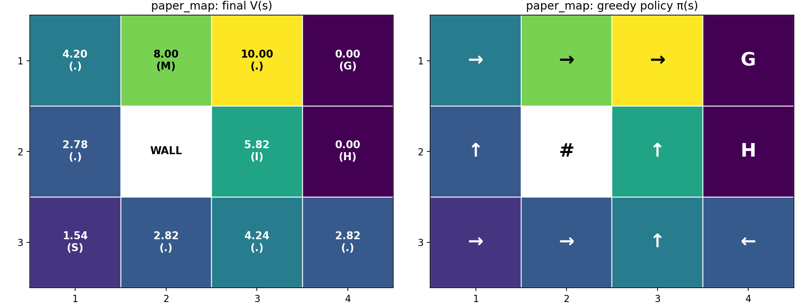
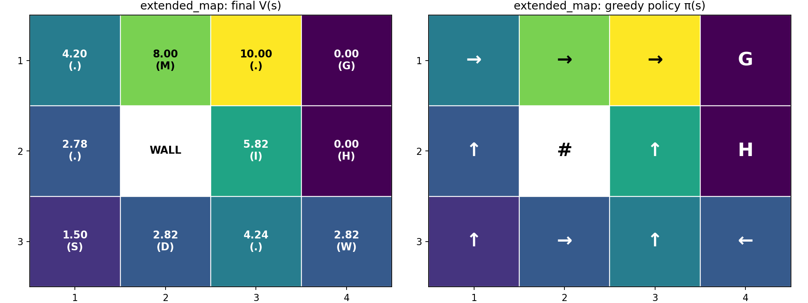

# HW6 — Grid World: Calculate, Simulate, Solve

**Course:** CSS-4007 — Artificial Intelligence  
**Assignment:** HW6

## AI-use declaration

I used ChatGPT to help explain the assignment, develop and review Python code,
organize results, and draft the written report. The numerical outputs in this
report must come from actual program runs; no missing experiments are assumed
successful. The generated calculations and results should be reviewed before submission.

## Setup and reproduction

1. Install Python dependencies in your Colab or virtual environment:

```bash
python -m pip install gymnasium numpy pandas matplotlib
```

2. Run the experiments and the custom solver:

```bash
python hw6_part_b.py
python hw6_part_c.py
python build_hw6_submission.py
```

Part B uses Gymnasium `FrozenLake-v1`; Part C implements its own transition model
from `maps.json` and does not use FrozenLake's dynamics. Neither part requires an API key.

**Recorded Part B environment versions:** Run Part B to record actual package versions in `outputs/part_b_versions.json`.

## Part A — Paper calculations


### 1. MDP Definition

I completed the Grid World calculations by hand.

The Markov Decision Process (MDP) consists of:

- States: All grid cells except the wall.
- Actions: Up, Right, Down, Left.
- Transitions: Deterministic movement on normal tiles and
  probabilistic movement on ice.
- Rewards: -1 for normal floor, -3 for mud,
  +10 for the goal, and -10 for the hole.
- Discount factor: gamma = 0.9.

The agent's goal is to maximize the expected
discounted reward.

### 2. Value Iteration

The Bellman optimality update is:

$$
V_{k+1}(s) =
\max_a \sum_{s'} P(s'|s,a)
[R(s,a,s') + 0.9V_k(s')]
$$

The initial values are V0 = 0.


### 3. Handwritten Calculations

The following photographs show my handwritten
calculations for V1, V2, and the best actions.

**Page 1 — MDP and initial calculations**


**Page 2 — Value Iteration calculations**


**Page 3 — Final calculations and best actions**


### 4. V2 Results

| Position | V2 | Best Action |
|---|---:|---|
| (1,2) Mud | 8.00 | Right |
| (1,3) Floor | 10.00 | Right |
| (2,3) Ice | 5.21 | Up |

The calculations use V1 values for all V2 updates.

At the ice tile, movement probabilities are
0.8 for the intended direction and 0.1
for each perpendicular direction.

There are no tied best actions at these positions.

### 5. Conclusion

The first two value iteration rounds show
how expected rewards influence the best actions.

However, two iterations are not enough to prove
that the policy is optimal.

More iterations are needed until the values converge.


## Part B — FrozenLake simulations

### Environment and goal

I used `FrozenLake-v1` with `map_name="4x4"`, default rewards, and the layout:

```text
S F F F
F H F H
F F F H
H F F G
```

`S` is the start, `F` safe frozen floor, `H` a hole and `G` the goal.
A goal gives reward 1; other transitions give reward 0. I did **not** change
FrozenLake's default rewards or slipping probabilities. Each episode is stopped
on `terminated`, `truncated`, or the 100-step limit; if the 100th step reaches
G/H, the terminal outcome is recorded before the time limit.

### Fixed policy, selected before experiments

The fixed state-dependent policy uses one action for every nonterminal state.
The directions below are the same throughout all experiments; they are not trained.

```text
↓  →  ↓  ←
↓  H  ↓  H
→  →  ↓  H
H  →  →  G
```

State-to-action mapping (Gymnasium: 0=left, 1=down, 2=right, 3=up):

| State | 0 | 1 | 2 | 3 | 4 | 6 | 8 | 9 | 10 | 13 | 14 |
| --- | --- | --- | --- | --- | --- | --- | --- | --- | --- | --- | --- |
| Action | down | right | down | left | down | down | right | right | down | right | right |

On the non-slippery map, the fixed policy follows a safe route
`0 → 4 → 8 → 9 → 10 → 14 → 15` (goal). On slippery ice, a requested
move can have a different outcome; the policy itself remains unchanged.
This design intentionally avoids the known hole squares (5, 7, 11, 12).

### Simulation method

I compared four conditions: random/fixed policy crossed with
`is_slippery=False` / `is_slippery=True`.
Each condition has three batches of 50 episodes (batch seeds 11, 22, 33),
for **600 episodes in total**. Episode `i` uses reset seed
`1000 * batch_seed + i`, `i = 0..49`. Random actions also use an
explicit NumPy random generator initialized with the episode seed.
The same list of episode seeds is reused in all four conditions.

- **Random policy:** samples one of the four actions with equal probability.
- **Fixed policy:** looks up the chosen action for the current state; no learning.

### Batch results

**Part B measurements pending:** run `python hw6_part_b.py`, then `python build_hw6_submission.py` to fill the table automatically. No unobserved values are reported as results.

| Slippery? | Policy | Batch seed | Goals /50 | Holes /50 | Time limits /50 | Success % | Mean steps |
| --- | --- | --- | --- | --- | --- | --- | --- |
| False | random | 11 | — | — | — | — | — |
| False | random | 22 | — | — | — | — | — |
| False | random | 33 | — | — | — | — | — |
| False | fixed | 11 | — | — | — | — | — |
| False | fixed | 22 | — | — | — | — | — |
| False | fixed | 33 | — | — | — | — | — |
| True | random | 11 | — | — | — | — | — |
| True | random | 22 | — | — | — | — | — |
| True | random | 33 | — | — | — | — | — |
| True | fixed | 11 | — | — | — | — | — |
| True | fixed | 22 | — | — | — | — | — |
| True | fixed | 33 | — | — | — | — | — |

### Interpretation

- Compare goal counts, time limits, and mean steps after the actual batch results are generated.

When `is_slippery=False`, the chosen action is executed as requested.
When `is_slippery=True`, FrozenLake can move in a different direction,
which introduces transition uncertainty and can cause falls into holes.
The difference between the three batches measures sampling variability.
A single successful episode is insufficient to estimate a policy's success rate:
many independent episodes and repeated batches provide stronger evidence.

These runs are **not training**: neither the random policy nor the fixed
policy is updated from the reward, and the fixed state-to-action mapping
remains constant. The simulations evaluate policies rather than improve them.

### Saved evidence

- [All 600 episode rows](outputs/part_b_episodes.csv)
- [12-batch summary](outputs/part_b_batch_summary.csv)
- [Fixed policy before experiments](outputs/part_b_fixed_policy.json)
- [Successful episode trace](outputs/part_b_success_trace.txt)
- [Failed episode trace](outputs/part_b_failure_trace.txt)
- [Success-rate chart](outputs/part_b_success_rates.png)
- [Runtime versions](outputs/part_b_versions.json)

If no successful or failed episode occurred in the observed batches, the
corresponding trace is not required and this should be stated explicitly.

## Part C — Custom Grid World Solver

### Implementation and mathematical model

I implemented synchronous value iteration from scratch in Python, using the exact supplied maps and transitions in `maps.json`. The Bellman update is `V_new(s) = max_a Σ P(s'|s,a)[R(s,a,s') + 0.9 V_old(s')]`. Both terminal values are zero. Ice slips with 0.8 for the intended action and 0.1 per perpendicular action; blocked movements stay and receive the destination tile's reward.

### Comparison with my Part A calculations

The code calculates V1 and all four action values for the three requested V2 cells. The checked values are:

| Position (row,col) | V2 | Best action |
| --- | ---: | --- |
| (1,2) | 8.00 | right |
| (1,3) | 10.00 | right |
| (2,3) | 5.21 | up |

See `outputs/part_c/paper_comparison.json` for V1 and all the action calculations. Any discrepancy with a handwritten calculation should be corrected using that transition-by-transition comparison.

### Convergence and optimal policies

| Map | Iterations | Final maximum change | Converged |
| --- | ---: | ---: | --- |
| paper_map | 12 | 2.165293105e-07 | Yes |
| extended_map | 11 | 2.405881232e-07 | Yes |

Both maps were solved with tolerance `1e-6` and safeguard `10000` iterations. I broke exact ties using the action order `up, right, down, left`.

The solver generates value and policy maps in `outputs/part_c/`. For reliable rendering in this GitHub report, copies of the two PNG figures are also included at the repository root, alongside `SUBMISSION.md`.

### Value maps and optimal policies (figures)

**Original map**  


**Extended map (sand and shallow water)**  


### Simulated policy results (150 episodes per map)

| Map | Batch seed | Goals /50 | Holes /50 | Time limits /50 | Mean steps | Mean discounted return |
| --- | ---: | ---: | ---: | ---: | ---: | ---: |
| paper_map | 11 | 42 | 8 | 0 | 4.98 | 0.8913 |
| paper_map | 22 | 46 | 4 | 0 | 5.04 | 1.9148 |
| paper_map | 33 | 48 | 2 | 0 | 5.04 | 2.4921 |
| extended_map | 11 | 50 | 0 | 0 | 5.00 | 1.5020 |
| extended_map | 22 | 50 | 0 | 0 | 5.00 | 1.5020 |
| extended_map | 33 | 50 | 0 | 0 | 5.00 | 1.5020 |

Every episode uses `episode_seed = 1000 * batch_seed + i` with `i=0..49`, and a 100-step limit. Discounted return is calculated as `sum(0.9**t * reward_t)` for t starting at zero. These are finite samples, whereas value iteration computes an expected infinite-horizon value.

### Comparing the maps

The extended map replaces ordinary floor at (3,2) with sand (reward -2), and (3,4) with shallow water (reward -5). Both new floor types move deterministically. The full comparison is saved in `outputs/part_c/map_comparison.csv`.

| Position | Tile change | Original V | Extended V | Original action | Extended action |
| --- | --- | ---: | ---: | --- | --- |
| (3,1) | S→S | 1.536 | 1.502 | right | up |

In these actual results, only the start state (3,1) changed its optimal action: right in the original map and up in the extended map. Entering sand at (3,2) now costs -2 instead of -1, so the deterministic upper route becomes preferable. The water at (3,4) is avoided, and the optimal values at (3,2) and (3,4) themselves stay the same because rewards are paid on entry to the destination, not upon leaving a tile. On ice at (2,3), action values still include all three movement outcomes and hole risk.

In the original-map batches, failures by falling into the hole were observed; in the extended-map batches, the chosen policy always reached the goal, so no failure trace exists for that map. The original map has a start value close to 1.53582 and the extended map has a start value close to 1.50200. The simulated sample means need not equal these expected values (especially in a stochastic map).

### Validation

I checked wall/boundary stays, transition probabilities summing to one, the 0.8/0.1/0.1 ice outcomes, mud (-3), sand (-2), water (-5), goal (+10), hole (-10), and no further rewards after terminal states. The detailed output is in `outputs/part_c/rule_checks.txt`.

### Files and reproduction

```bash
python hw6_part_c.py
```

The code uses only Python's standard library for calculations and simulation; Matplotlib is optional for PNG plots. The output folder also includes the per-episode CSV, summary CSV, policy/value CSVs, examples of success/failure traces, and a map-comparison CSV.
