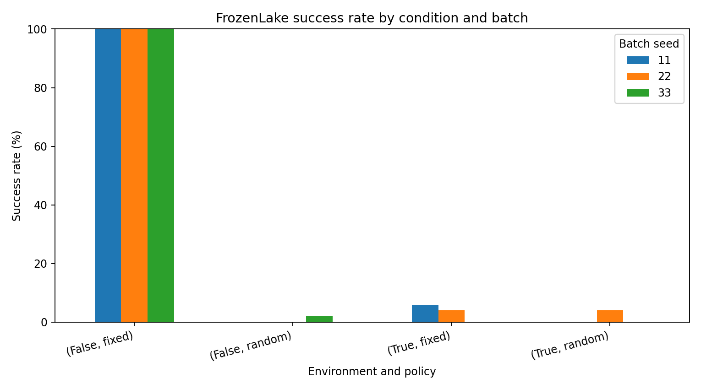

# HW6 — Grid World: Calculate, Simulate, Solve

**Course:** CSS-4007 — Artificial Intelligence  
**Assignment:** HW6

## AI-use declaration

I used ChatGPT to help explain the assignment, develop and review Python code,
organize results, and draft the written report. The numerical outputs in this
report must come from actual program runs; no missing experiments are assumed
successful. The generated calculations and results should be reviewed before submission.

## Setup and reproduction

1. Install Python dependencies in your Colab or virtual environment:

```bash
python -m pip install gymnasium numpy pandas matplotlib
```

2. Run the experiments and the custom solver:

```bash
python hw6_part_b.py
python hw6_part_c.py
python build_hw6_submission.py
```

Part B uses Gymnasium `FrozenLake-v1`; Part C implements its own transition model
from `maps.json` and does not use FrozenLake's dynamics. Neither part requires an API key.

**Recorded Part B environment versions:** Run Part B to record actual package versions in `outputs/part_b_versions.json`.

## Part A — Paper calculations


### 1. MDP Definition

I completed the Grid World calculations by hand.

The Markov Decision Process (MDP) consists of:

- States: All grid cells except the wall.
- Actions: Up, Right, Down, Left.
- Transitions: Deterministic movement on normal tiles and
  probabilistic movement on ice.
- Rewards: -1 for normal floor, -3 for mud,
  +10 for the goal, and -10 for the hole.
- Discount factor: gamma = 0.9.

The agent's goal is to maximize the expected
discounted reward.

### 2. Value Iteration

The Bellman optimality update is:

$$
V_{k+1}(s) =
\max_a \sum_{s'} P(s'|s,a)
[R(s,a,s') + 0.9V_k(s')]
$$

The initial values are V0 = 0.


### 3. Handwritten Calculations

The following photographs show my handwritten
calculations for V1, V2, and the best actions.

**Page 1 — MDP and initial calculations**


**Page 2 — Value Iteration calculations**


**Page 3 — Final calculations and best actions**


### 4. V2 Results

| Position | V2 | Best Action |
|---|---:|---|
| (1,2) Mud | 8.00 | Right |
| (1,3) Floor | 10.00 | Right |
| (2,3) Ice | 5.21 | Up |

The calculations use V1 values for all V2 updates.

At the ice tile, movement probabilities are
0.8 for the intended direction and 0.1
for each perpendicular direction.

There are no tied best actions at these positions.

### 5. Conclusion

The first two value iteration rounds show
how expected rewards influence the best actions.

However, two iterations are not enough to prove
that the policy is optimal.

More iterations are needed until the values converge.


## Part B — FrozenLake Simulations

### 1. Environment and Goal

I used the Gymnasium FrozenLake-v1 environment with
a 4×4 map.

The goal is to move the agent from the starting
position (S) to the goal (G) without falling
into a hole (H).

The map is:

```text
S F F F
F H F H
F F F H
H F F G
```

S = Start  
F = Frozen floor  
H = Hole  
G = Goal

The goal reward is 1. All other rewards are 0.

### 2. Policies

I compared two policies:

**Random Policy**

The agent chooses one of four actions randomly:
left, down, right, or up.

**Fixed Policy**

The agent follows a predefined action for each state.

The fixed policy is:

```text
↓ → ↓ ←
↓ H ↓ H
→ → ↓ H
H → → G
```

The fixed policy was selected before running
the experiments. It does not learn or change.

### 3. Experimental Setup

I tested four conditions:

1. Random policy, non-slippery
2. Fixed policy, non-slippery
3. Random policy, slippery
4. Fixed policy, slippery

Each condition was tested using three batches,
with random seeds 11, 22, and 33.

Each batch contained 50 episodes.

Total number of episodes:

2 policies × 2 slippery settings × 3 batches
× 50 episodes = 600 episodes.

The maximum episode length was 100 steps.

When is_slippery=False, the agent moves
in the selected direction.

When is_slippery=True, the movement is stochastic.


### 4. Experimental Results

I ran 600 episodes in total, using three batches
of 50 episodes for each experimental condition.

| Slippery? | Policy | Seed | Goals /50 | Holes /50 | Time limits /50 | Success % | Mean steps |
|---|---|---:|---:|---:|---:|---:|---:|
| False | random | 11 | 0 | 50 | 0 | 0.0 | 7.98 |
| False | random | 22 | 0 | 50 | 0 | 0.0 | 6.42 |
| False | random | 33 | 1 | 49 | 0 | 2.0 | 6.66 |
| False | fixed | 11 | 50 | 0 | 0 | 100.0 | 6.00 |
| False | fixed | 22 | 50 | 0 | 0 | 100.0 | 6.00 |
| False | fixed | 33 | 50 | 0 | 0 | 100.0 | 6.00 |
| True | random | 11 | 0 | 50 | 0 | 0.0 | 8.30 |
| True | random | 22 | 2 | 48 | 0 | 4.0 | 7.76 |
| True | random | 33 | 0 | 50 | 0 | 0.0 | 6.74 |
| True | fixed | 11 | 3 | 47 | 0 | 6.0 | 4.52 |
| True | fixed | 22 | 2 | 48 | 0 | 4.0 | 5.06 |
| True | fixed | 33 | 0 | 50 | 0 | 0.0 | 4.06 |

The complete results are available in
[part_b_batch_summary.csv](part_b_batch_summary.csv).

### 5. Results Interpretation

The fixed policy achieved a 100% success rate
in the non-slippery environment.

The random policy performed poorly because
it selected actions without following a safe route.

In the slippery environment, both policies had
low success rates because the agent could move
in an unintended direction and fall into holes.

These results show that movement uncertainty
can strongly affect policy performance.

### 6. Success Rate Graph




### 6. Interpretation

The random policy selects actions without
considering the goal or the holes.

The fixed policy follows predefined directions
to reach the goal.

In the non-slippery environment, the fixed
policy follows a safe route to the goal.

In the slippery environment, the agent may
move in an unintended direction. This makes
the outcome uncertain.

Repeating the experiments with different seeds
helps us observe the effect of randomness.

These experiments evaluate the policies.
They do not train the agent.

### 7. Saved Files

The following files contain the code,
experimental results, and evidence.

- [Python implementation](hw6_part_b.py)
- [All 600 episodes](part_b_episodes.csv)
- [Summary of 12 batches](part_b_batch_summary.csv)
- [Success rate graph](part_b_success_rates.png)
- [Fixed policy](part_b_fixed_policy.json)
- [Successful episode trace](part_b_success_trace.txt)
- [Failed episode trace](part_b_failure_trace.txt)
- [Library versions](part_b_versions.json)

### 8. Conclusion

In this experiment, I compared a random policy
and a fixed policy in the FrozenLake environment.

I tested both policies under slippery and
non-slippery conditions.

I used 600 episodes in total and recorded
successes, failures, time limits, and steps.

This experiment demonstrates how a predefined
policy and uncertainty in movement affect
the agent's performance.

## Part C — Custom Grid World Solver

### Implementation and mathematical model

I implemented synchronous value iteration from scratch in Python, using the exact supplied maps and transitions in `maps.json`. The Bellman update is `V_new(s) = max_a Σ P(s'|s,a)[R(s,a,s') + 0.9 V_old(s')]`. Both terminal values are zero. Ice slips with 0.8 for the intended action and 0.1 per perpendicular action; blocked movements stay and receive the destination tile's reward.

### Comparison with my Part A calculations

The code calculates V1 and all four action values for the three requested V2 cells. The checked values are:

| Position (row,col) | V2 | Best action |
| --- | ---: | --- |
| (1,2) | 8.00 | right |
| (1,3) | 10.00 | right |
| (2,3) | 5.21 | up |

See `outputs/part_c/paper_comparison.json` for V1 and all the action calculations. Any discrepancy with a handwritten calculation should be corrected using that transition-by-transition comparison.

### Convergence and optimal policies

| Map | Iterations | Final maximum change | Converged |
| --- | ---: | ---: | --- |
| paper_map | 12 | 2.165293105e-07 | Yes |
| extended_map | 11 | 2.405881232e-07 | Yes |

Both maps were solved with tolerance `1e-6` and safeguard `10000` iterations. I broke exact ties using the action order `up, right, down, left`.

The solver generates value and policy maps in `outputs/part_c/`. For reliable rendering in this GitHub report, copies of the two PNG figures are also included at the repository root, alongside `SUBMISSION.md`.

### Value maps and optimal policies (figures)

**Original map**  


**Extended map (sand and shallow water)**  


### Simulated policy results (150 episodes per map)

| Map | Batch seed | Goals /50 | Holes /50 | Time limits /50 | Mean steps | Mean discounted return |
| --- | ---: | ---: | ---: | ---: | ---: | ---: |
| paper_map | 11 | 42 | 8 | 0 | 4.98 | 0.8913 |
| paper_map | 22 | 46 | 4 | 0 | 5.04 | 1.9148 |
| paper_map | 33 | 48 | 2 | 0 | 5.04 | 2.4921 |
| extended_map | 11 | 50 | 0 | 0 | 5.00 | 1.5020 |
| extended_map | 22 | 50 | 0 | 0 | 5.00 | 1.5020 |
| extended_map | 33 | 50 | 0 | 0 | 5.00 | 1.5020 |

Every episode uses `episode_seed = 1000 * batch_seed + i` with `i=0..49`, and a 100-step limit. Discounted return is calculated as `sum(0.9**t * reward_t)` for t starting at zero. These are finite samples, whereas value iteration computes an expected infinite-horizon value.

### Comparing the maps

The extended map replaces ordinary floor at (3,2) with sand (reward -2), and (3,4) with shallow water (reward -5). Both new floor types move deterministically. The full comparison is saved in `outputs/part_c/map_comparison.csv`.

| Position | Tile change | Original V | Extended V | Original action | Extended action |
| --- | --- | ---: | ---: | --- | --- |
| (3,1) | S→S | 1.536 | 1.502 | right | up |

In these actual results, only the start state (3,1) changed its optimal action: right in the original map and up in the extended map. Entering sand at (3,2) now costs -2 instead of -1, so the deterministic upper route becomes preferable. The water at (3,4) is avoided, and the optimal values at (3,2) and (3,4) themselves stay the same because rewards are paid on entry to the destination, not upon leaving a tile. On ice at (2,3), action values still include all three movement outcomes and hole risk.

In the original-map batches, failures by falling into the hole were observed; in the extended-map batches, the chosen policy always reached the goal, so no failure trace exists for that map. The original map has a start value close to 1.53582 and the extended map has a start value close to 1.50200. The simulated sample means need not equal these expected values (especially in a stochastic map).

### Validation

I checked wall/boundary stays, transition probabilities summing to one, the 0.8/0.1/0.1 ice outcomes, mud (-3), sand (-2), water (-5), goal (+10), hole (-10), and no further rewards after terminal states. The detailed output is in `outputs/part_c/rule_checks.txt`.

### Files and reproduction

```bash
python hw6_part_c.py
```

The code uses only Python's standard library for calculations and simulation; Matplotlib is optional for PNG plots. The output folder also includes the per-episode CSV, summary CSV, policy/value CSVs, examples of success/failure traces, and a map-comparison CSV.
